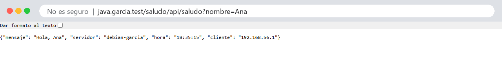
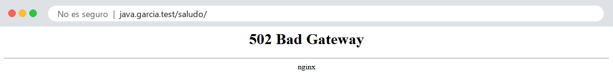
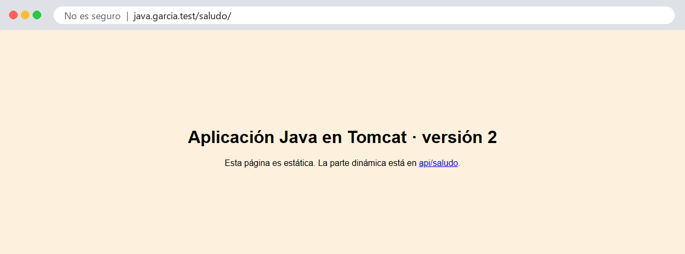

<!--
NOTA PARA EL PROFESOR (no se muestra al alumnado):

Reescrita a partir de P3.1-Wildfly.md (API REST con Jakarta en WildFly, Maven) y old.P3.1-Tomcat.md. Cambios:
  - SERVIDOR: Tomcat 10 del repositorio de Debian 13 (paquete tomcat10 10.1.55) en lugar de WildFly descargado a
    mano. Motivos: viene como servicio systemd, se actualiza con apt, ~145 MB de RAM con la aplicación (medido en la VM)
    (la VM tiene 2 GB) y es la base de Spring Boot. DECISIÓN A CONFIRMAR con el profesor.
  - Aplicación propia mínima (un servlet que devuelve JSON + un index.html) en lugar de la API REST del original:
    se ve el WAR entero, cabe en una pantalla y se escribe en clase. Paquete es.sjo.daw.
  - jakarta.servlet-api 6.0.0 con scope provided; maven.compiler.release 21 (default-jdk-headless de Debian 13 es
    OpenJDK 21). Comprobado que un servlet con javax.servlet se despliega sin errores y da 404 (cuestión 3 del tema).
  - Añadido: Nginx delante (java.apellido.test, include proxy_params), RemoteIpValve para la IP real, Connector
    solo en 127.0.0.1, despliegue de una versión nueva con copia de la anterior para volver atrás, y el 502.
  - unzip no viene en Debian 13: para ver el WAR se usa "jar tf", que trae el JDK.
  - Tomcat tarda unos segundos en desplegar un WAR copiado (revisa webapps cada 10 s): si un alumno prueba al
    instante y ve 404, que espere y mire journalctl.

VALIDADA el 27/10/2026 en contenedor Debian 13 con systemd (mismos paquetes que la VM).

Validado en VM el 15/11/2026: VM importada de DAW-debian.ova (Debian 13.7, kernel 6.12.107, 2 GB, 2 CPU) con el
estado final del Tema 2 (Nginx 1.26.3 con web1 por HTTPS y web2). openjdk 21.0.13, maven 3.9.9, tomcat10 10.1.60.
Todas las salidas son ya de la VM; curl.exe probados desde el Windows anfitrión (curl 8.x con --resolve).
Cambios y hallazgos:
  - apt: 64 paquetes, 155 MB de descarga y 348 MB en disco. Se dice en el apartado 2.
  - RAM: Tomcat recién instalado ocupa unos 90 MB y, con la aplicación desplegada, unos 145 MB (no ~200).
    Nginx, unos 6 MB. Corregido el texto.
  - /etc/tomcat10/server.xml es root:tomcat 640: el usuario no lo puede leer. La evidencia 7 hacía
    "grep ... /etc/tomcat10/server.xml" sin sudo (Permission denied). Ahora con sudo, y avisado de que sale también
    el address="::1" del conector AJP, que viene comentado.
  - Desde Windows, curl.exe contra el 8080 cerrado tarda 2 s en dar 000 (Windows reintenta la conexión): avisado.
  - Arranque de Tomcat en la VM: unos 5 s con la aplicación; el primero, recién instalado, 47 s (con apt aún
    trabajando). El 502 tras "start" duró unos 15 s: el texto ya lo avisaba.
  - "Pon en el título" era ambiguo (<title> o <h1>): ahora se cambia el <h1>, que es lo que se ve.
  - Capturas nuevas: T3-tomcat-api.png (JSON con la IP real), T3-tomcat-502.png y T3-tomcat-saludo.png (versión 2).
-->

# Práctica 3.1 - Aplicación Java en Tomcat detrás de Nginx

!!! tip "Cuándo se hace"
    Al terminar el **bloque 2** de la [teoría del Tema 3](T3-servidores-aplicaciones.md), con las prácticas del Tema 2 terminadas. Se hace en la **máquina principal** (`192.168.56.10`); no necesitas los clones.

!!! abstract "Objetivos"
    Al terminar esta práctica deberás ser capaz de:

    1. Instalar un entorno Java (JDK, Maven y Tomcat) desde los repositorios de Debian.
    2. Crear un proyecto Maven y construir con él un WAR.
    3. Desplegar el WAR en Tomcat y seguir el despliegue en el registro.
    4. Publicar Tomcat a través de Nginx y pasarle la IP real del cliente.
    5. Hacer que Tomcat solo acepte conexiones locales.
    6. Desplegar una versión nueva y saber volver a la anterior.

---

## 1. Qué vas a montar

```
 Tu ordenador         debian-tuapellido (192.168.56.10)
 192.168.56.1  ───►   Nginx :80  ──── java.tuapellido.test ───►  Tomcat 127.0.0.1:8080
                                                                   └── /saludo/  (saludo.war)
```

Una aplicación Java mínima: una página estática y un servlet en `/saludo/api/saludo` que responde en JSON con un saludo, el nombre del servidor, la hora y la IP del cliente. Lo importante no es la aplicación, sino el camino completo: código → Maven → WAR → Tomcat → Nginx → navegador.

En los ejemplos, el apellido es `garcia`. Usa el tuyo en todos los nombres.

## 2. Instalar Java, Maven y Tomcat

```sh
sudo apt update
sudo apt install default-jdk-headless maven tomcat10
```

- `default-jdk-headless`: el JDK de Debian 13 (OpenJDK 21) sin librerías gráficas. El JDK incluye la JVM y el compilador `javac`.
- `maven`: la herramienta de construcción.
- `tomcat10`: Tomcat 10.1, ya instalado como servicio y arrancado.

Son 64 paquetes: unos 155 MB de descarga y 350 MB en disco. Ten paciencia; al terminar, Tomcat tarda todavía un poco en arrancar la primera vez.

Comprueba las versiones y el servicio:

```sh
java -version
mvn -v | head -1
systemctl status tomcat10
```

```
openjdk version "21.0.13" 2026-10-20
OpenJDK Runtime Environment (build 21.0.13+9-1-deb13u2-Debian)
OpenJDK 64-Bit Server VM (build 21.0.13+9-1-deb13u2-Debian, mixed mode, sharing)
Apache Maven 3.9.9
```

Las versiones exactas pueden ser algo más nuevas en tu máquina: Debian publica actualizaciones de seguridad. En `systemctl status` debes ver `active (running)` y, en la línea `Memory`, unos 90 MB: es lo que ocupa una JVM con Tomcat sin nada tuyo desplegado, y subirá a unos 150 MB con tu aplicación. Compara con `systemctl status nginx`: unos 6 MB.

Ahora mismo Tomcat escucha en el puerto 8080 de **todas** las interfaces. Entra desde tu navegador en `http://192.168.56.10:8080`: verás la página `It works !` de Tomcat. Lo cerrarás en el apartado 7.

## 3. Crear el proyecto Maven

Trabaja en tu carpeta personal. Crea la estructura de carpetas que espera Maven:

```sh
mkdir -p ~/saludo/src/main/java/es/sjo/daw ~/saludo/src/main/webapp
cd ~/saludo
```

```
saludo/
├── pom.xml
└── src/main/
    ├── java/es/sjo/daw/SaludoServlet.java   ← código Java
    └── webapp/index.html                    ← ficheros web estáticos
```

### El `pom.xml`

```sh
nano pom.xml
```

```xml
<?xml version="1.0" encoding="UTF-8"?>
<project xmlns="http://maven.apache.org/POM/4.0.0"
         xmlns:xsi="http://www.w3.org/2001/XMLSchema-instance"
         xsi:schemaLocation="http://maven.apache.org/POM/4.0.0 https://maven.apache.org/xsd/maven-4.0.0.xsd">
  <modelVersion>4.0.0</modelVersion>

  <groupId>es.sjo.daw</groupId>
  <artifactId>saludo</artifactId>
  <version>1.0</version>
  <packaging>war</packaging>

  <properties>
    <maven.compiler.release>21</maven.compiler.release>
    <project.build.sourceEncoding>UTF-8</project.build.sourceEncoding>
  </properties>

  <dependencies>
    <dependency>
      <groupId>jakarta.servlet</groupId>
      <artifactId>jakarta.servlet-api</artifactId>
      <version>6.0.0</version>
      <scope>provided</scope>
    </dependency>
  </dependencies>

  <build>
    <finalName>saludo</finalName>
  </build>
</project>
```

- `packaging` `war`: el artefacto será un WAR.
- `maven.compiler.release` `21`: compila para Java 21, la versión que tienes instalada.
- `jakarta.servlet-api` 6.0.0 es la versión de servlets de Tomcat 10.1. Con `provided`, Maven la usa para compilar pero no la mete en el WAR: en el servidor la pone Tomcat.
- `finalName`: el WAR se llamará `saludo.war` (sin esto, `saludo-1.0.war`). Recuerda que el nombre del WAR decide la URL.

### El servlet

```sh
nano src/main/java/es/sjo/daw/SaludoServlet.java
```

```java
package es.sjo.daw;

import jakarta.servlet.annotation.WebServlet;
import jakarta.servlet.http.HttpServlet;
import jakarta.servlet.http.HttpServletRequest;
import jakarta.servlet.http.HttpServletResponse;
import java.io.IOException;
import java.net.InetAddress;
import java.time.LocalTime;
import java.time.temporal.ChronoUnit;

@WebServlet("/api/saludo")
public class SaludoServlet extends HttpServlet {

    @Override
    protected void doGet(HttpServletRequest req, HttpServletResponse resp) throws IOException {
        String nombre = req.getParameter("nombre");
        if (nombre == null || nombre.isBlank()) {
            nombre = "mundo";
        }
        nombre = nombre.replaceAll("[^\\p{L}\\p{N} ]", "");

        resp.setContentType("application/json;charset=UTF-8");
        resp.getWriter().printf(
            "{\"mensaje\": \"Hola, %s\", \"servidor\": \"%s\", \"hora\": \"%s\", \"cliente\": \"%s\"}%n",
            nombre,
            InetAddress.getLocalHost().getHostName(),
            LocalTime.now().truncatedTo(ChronoUnit.SECONDS),
            req.getRemoteAddr());
    }
}
```

- `@WebServlet("/api/saludo")`: la ruta que atiende, **dentro** del contexto. La URL completa será `/saludo/api/saludo`.
- `req.getParameter("nombre")`: lee el `?nombre=` de la URL. La línea del `replaceAll` deja solo letras, números y espacios: nunca metas en una respuesta lo que te manda el cliente sin limpiarlo.
- `req.getRemoteAddr()`: la IP de quien se conecta a Tomcat. Fíjate en ella en los apartados 6 y 7.

### La página estática

```sh
nano src/main/webapp/index.html
```

```html
<!DOCTYPE html>
<html lang="es">
<head><meta charset="utf-8"><title>Saludo · Tomcat</title></head>
<body style="font-family:sans-serif;background:#fdf0dc;text-align:center;padding-top:12%">
<h1>Aplicación Java en Tomcat</h1>
<p>Esta página es estática. La parte dinámica está en <a href="api/saludo?nombre=Ana">api/saludo</a>.</p>
</body>
</html>
```

## 4. Construir el WAR

Desde `~/saludo`:

```sh
mvn package
```

La primera vez, Maven descarga de Maven Central sus propios plugins y la librería de servlets: verás más de doscientas líneas `Downloading from central`. Se guardan en `~/.m2/repository` y las siguientes construcciones ya no descargan nada. El final debe ser este:

```
[INFO] --- compiler:3.13.0:compile (default-compile) @ saludo ---
[INFO] Recompiling the module because of changed dependency.
[INFO] Compiling 1 source file with javac [debug release 21] to target/classes
[INFO] 
[INFO] --- resources:3.3.1:testResources (default-testResources) @ saludo ---
[INFO] skip non existing resourceDirectory /home/garcia/saludo/src/test/resources
[INFO] 
[INFO] --- compiler:3.13.0:testCompile (default-testCompile) @ saludo ---
[INFO] No sources to compile
[INFO] 
[INFO] --- surefire:2.17:test (default-test) @ saludo ---
[INFO] No tests to run.
[INFO] 
[INFO] --- war:3.4.0:war (default-war) @ saludo ---
[INFO] Packaging webapp
[INFO] Assembling webapp [saludo] in [/home/garcia/saludo/target/saludo]
[INFO] Processing war project
[INFO] Copying webapp resources [/home/garcia/saludo/src/main/webapp]
[INFO] Building war: /home/garcia/saludo/target/saludo.war
[INFO] ------------------------------------------------------------------------
[INFO] BUILD SUCCESS
[INFO] ------------------------------------------------------------------------
```

Fíjate en las fases del ciclo de vida, en orden: `compile`, `test` (no hay pruebas) y `war`, que es la fase `package` de un proyecto WAR. Mira qué hay dentro del WAR (`unzip` no viene instalado en Debian, pero el JDK trae `jar`):

```sh
jar tf target/saludo.war
```

```
META-INF/
META-INF/MANIFEST.MF
WEB-INF/
WEB-INF/classes/
WEB-INF/classes/es/
WEB-INF/classes/es/sjo/
WEB-INF/classes/es/sjo/daw/
WEB-INF/classes/es/sjo/daw/SaludoServlet.class
index.html
META-INF/maven/es.sjo.daw/saludo/pom.xml
META-INF/maven/es.sjo.daw/saludo/pom.properties
```

El `.java` no está: en el servidor solo va el `.class` compilado. Y no hay ninguna librería en `WEB-INF/lib`: la de servlets era `provided`.

!!! warning "Si Maven falla"
    `BUILD FAILURE` con `cannot find symbol` es un error de Java: revisa el código y los `import`. Si el error habla de `release 21`, comprueba con `java -version` que tienes el JDK 21.

## 5. Desplegar en Tomcat

Desplegar es copiar el WAR a la carpeta de aplicaciones de Tomcat:

```sh
sudo cp target/saludo.war /var/lib/tomcat10/webapps/
```

Tomcat revisa esa carpeta cada pocos segundos. Sigue el despliegue en su registro:

```sh
sudo journalctl -u tomcat10 -n 3
```

```
Nov 15 16:40:44 debian-garcia tomcat10[2635]: Deploying web application archive [/var/lib/tomcat10/webapps/saludo.war]
Nov 15 16:40:45 debian-garcia tomcat10[2635]: At least one JAR was scanned for TLDs yet contained no TLDs. Enable debug logging for this logger for a complete list of JARs that were scanned but no TLDs were found in them. Skipping unneeded JARs during scanning can improve startup time and JSP compilation time.
Nov 15 16:40:45 debian-garcia tomcat10[2635]: Deployment of web application archive [/var/lib/tomcat10/webapps/saludo.war] has finished in [1,104] ms
```

El aviso de los TLD es informativo, no un error. Si en vez de esas líneas ves las del arranque de Tomcat (`Server startup in ...`), es que todavía no ha revisado la carpeta: espera unos segundos y repite. Mira la carpeta:

```sh
ls -l /var/lib/tomcat10/webapps/
```

```
total 12
drwxr-xr-x 3 root   root   4096 Nov 15 16:38 ROOT
drwxr-x--- 4 tomcat tomcat 4096 Nov 15 16:40 saludo
-rw-r--r-- 1 root   root   3204 Nov 15 16:40 saludo.war
```

Tomcat ha descomprimido el WAR en la carpeta `saludo/` (de su propiedad) y lo ha publicado en el contexto `/saludo`. `ROOT` es la aplicación de bienvenida, en `/`. Prueba la aplicación desde la propia máquina:

```sh
curl "http://127.0.0.1:8080/saludo/api/saludo?nombre=Ana"
```

```
{"mensaje": "Hola, Ana", "servidor": "debian-garcia", "hora": "16:40:55", "cliente": "127.0.0.1"}
```

## 6. Publicar con Nginx

### El sitio

En la práctica 2.4 escribiste a mano cuatro `proxy_set_header`. Debian trae esas mismas cuatro líneas en un fichero que puedes incluir:

```sh
grep -v '^#' /etc/nginx/proxy_params | grep .
```

```
proxy_set_header Host $host;
proxy_set_header X-Real-IP $remote_addr;
proxy_set_header X-Forwarded-For $proxy_add_x_forwarded_for;
proxy_set_header X-Forwarded-Proto $scheme;
```

Crea el sitio:

```sh
sudo nano /etc/nginx/sites-available/java.garcia.test
```

```nginx
server {
    listen 80;
    listen [::]:80;
    server_name java.garcia.test;

    access_log /var/log/nginx/java.access.log;
    error_log  /var/log/nginx/java.error.log;

    location / {
        proxy_pass http://127.0.0.1:8080;
        include proxy_params;
    }
}
```

Actívalo, comprueba y recarga, como siempre:

```sh
sudo ln -s /etc/nginx/sites-available/java.garcia.test /etc/nginx/sites-enabled/
sudo nginx -t
sudo systemctl reload nginx
```

En el fichero `hosts` de tu ordenador, añade el nombre a la línea de la `.10`:

```
192.168.56.10    web1.garcia.test    web2.garcia.test    app.garcia.test    java.garcia.test
```

Entra en `http://java.garcia.test/saludo/` y pulsa el enlace. Desde PowerShell:

```powershell
curl.exe "http://java.garcia.test/saludo/api/saludo?nombre=Ana"
```

```
{"mensaje": "Hola, Ana", "servidor": "debian-garcia", "hora": "16:41:07", "cliente": "127.0.0.1"}
```

Funciona, pero el cliente es `127.0.0.1`: para Tomcat, quien se conecta es Nginx. Es el mismo problema de la práctica 2.4.

### La IP real en Tomcat

En Tomcat, lo que hacía el módulo `realip` de Nginx lo hace una **válvula** (*valve*), un componente que procesa la petición antes de que llegue a la aplicación. Edita la configuración:

```sh
sudo nano /etc/tomcat10/server.xml
```

Busca, casi al final, la válvula `AccessLogValve` (dentro del bloque `<Host>`) y añade **encima** esta línea:

```xml
        <Valve className="org.apache.catalina.valves.RemoteIpValve" />

        <Valve className="org.apache.catalina.valves.AccessLogValve" directory="logs"
               prefix="localhost_access_log" suffix=".txt"
```

`RemoteIpValve` lee la cabecera `X-Forwarded-For` y la usa como IP del cliente, pero **solo** si la conexión viene de una dirección interna, como `127.0.0.1`: es el equivalente de `set_real_ip_from`. Tomcat no lee su configuración en caliente; reinícialo:

```sh
sudo systemctl restart tomcat10
```

El comando vuelve enseguida, pero Tomcat tarda unos segundos en estar listo: si la petición siguiente da `502`, espera y repite (lo verás con calma en el apartado 8).

```powershell
curl.exe "http://java.garcia.test/saludo/api/saludo?nombre=Ana"
```

```
{"mensaje": "Hola, Ana", "servidor": "debian-garcia", "hora": "16:41:35", "cliente": "192.168.56.1"}
```

En el navegador, `http://java.garcia.test/saludo/api/saludo?nombre=Ana`:



## 7. Que nadie se salte el proxy

Tomcat sigue respondiendo directamente a cualquiera en el 8080:

```powershell
curl.exe -s -o NUL -w "%{http_code}\n" http://192.168.56.10:8080/saludo/
```

```
200
```

En la práctica 2.4 lo resolviste con una regla en el servidor de detrás. Aquí es más sencillo, porque Tomcat está en la misma máquina que Nginx: basta con que **escuche solo en local**. En `/etc/tomcat10/server.xml`, busca el conector del puerto 8080 y añade `address="127.0.0.1"`:

```xml
    <Connector port="8080" protocol="HTTP/1.1"
               address="127.0.0.1"
               connectionTimeout="20000"
               redirectPort="8443"
               maxParameterCount="1000"
               />
```

```sh
sudo systemctl restart tomcat10
sudo ss -tlnp | grep 8080
```

```
LISTEN 0      100    [::ffff:127.0.0.1]:8080            *:*    users:(("java",pid=3300,fd=39))
```

`[::ffff:127.0.0.1]` es la forma en que Java escribe la `127.0.0.1` cuando escucha en IPv6: solo local. Prueba las dos rutas desde tu ordenador:

```powershell
curl.exe -s -o NUL -w "%{http_code}\n" http://192.168.56.10:8080/saludo/
curl.exe -s -o NUL -w "%{http_code}\n" http://java.garcia.test/saludo/
```

```
000
200
```

`000` significa que `curl` ni siquiera ha conseguido conectar: no hay nadie escuchando en esa dirección. El primero tarda un par de segundos porque Windows reintenta la conexión antes de rendirse. A través del proxy, `200`.

## 8. Cuando Tomcat no responde: 502

```sh
sudo systemctl stop tomcat10
```

Recarga `http://java.garcia.test/saludo/`:



La página de error es de Nginx, no de Tomcat. En el registro de errores del sitio:

```sh
sudo tail -n 1 /var/log/nginx/java.error.log
```

```
2026/11/15 16:44:32 [error] 3090#3090: *13 connect() failed (111: Connection refused) while connecting to upstream, client: 192.168.56.1, server: java.garcia.test, request: "GET /saludo/ HTTP/1.1", upstream: "http://127.0.0.1:8080/saludo/", host: "java.garcia.test"
```

El mismo `Connection refused` de la práctica 2.4: Nginx funciona, pero no hay nadie en `127.0.0.1:8080`. Vuelve a arrancarlo:

```sh
sudo systemctl start tomcat10
```

Tomcat tarda unos segundos en arrancar y desplegar las aplicaciones; durante ese tiempo, seguirás viendo el `502`.

## 9. Desplegar una versión nueva (y volver atrás)

Antes de sustituir nada, guarda la versión que funciona:

```sh
cp /var/lib/tomcat10/webapps/saludo.war ~/saludo-1.0.war
```

Cambia la aplicación: en `src/main/webapp/index.html`, cambia el encabezado por `<h1>Aplicación Java en Tomcat · versión 2</h1>`, y en el `pom.xml`, pon `<version>2.0</version>`. Construye y despliega:

```sh
mvn package
sudo cp target/saludo.war /var/lib/tomcat10/webapps/
sudo journalctl -u tomcat10 -n 4
```

```
Nov 15 16:48:13 debian-garcia tomcat10[3445]: Undeploying context [/saludo]
Nov 15 16:48:13 debian-garcia tomcat10[3445]: Deploying web application archive [/var/lib/tomcat10/webapps/saludo.war]
Nov 15 16:48:15 debian-garcia tomcat10[3445]: At least one JAR was scanned for TLDs yet contained no TLDs. Enable debug logging for this logger for a complete list of JARs that were scanned but no TLDs were found in them. Skipping unneeded JARs during scanning can improve startup time and JSP compilation time.
Nov 15 16:48:15 debian-garcia tomcat10[3445]: Deployment of web application archive [/var/lib/tomcat10/webapps/saludo.war] has finished in [1,268] ms
```

Tomcat ha detectado el WAR nuevo, ha retirado la versión anterior (`Undeploying`) y ha desplegado la nueva, **sin reiniciar**. Como en el apartado 5, si el registro aún no lo muestra, espera unos segundos. Recarga `http://java.garcia.test/saludo/`:



Ahora imagina que la versión 2 tiene un fallo grave. Volver atrás es un solo comando:

```sh
sudo cp ~/saludo-1.0.war /var/lib/tomcat10/webapps/saludo.war
```

Comprueba en el registro y en el navegador que vuelve la versión 1. Después, despliega otra vez la 2 para dejarla como versión final.

!!! info "En el mundo real"
    Nadie guarda las versiones en su carpeta personal: los artefactos de cada versión se guardan en un repositorio de artefactos (Nexus, Artifactory, GitHub Packages), que es justo adonde los sube `mvn deploy`. Y el despliegue lo hace un sistema automático (Tema 7).

## 10. Haz la instantánea

Apaga la máquina y toma una instantánea: `p3.1-tomcat`.

---

## Cuestiones finales

!!! question "Cuestión 1"
    ¿Qué hace exactamente `mvn package`? Nombra las fases que ha ejecutado en tu proyecto y di dónde ha dejado el resultado. ¿Qué haría además `mvn install`?

!!! question "Cuestión 2"
    ¿Por qué la URL de tu servlet es `/saludo/api/saludo` y no `/api/saludo`? ¿Qué harías para que la aplicación respondiera en la raíz de `java.tuapellido.test`?

!!! question "Cuestión 3"
    Antes de añadir `RemoteIpValve`, la aplicación decía que el cliente era `127.0.0.1`. ¿Por qué? ¿Qué riesgo habría si la válvula creyera la cabecera `X-Forwarded-For` viniera de quien viniera?

!!! question "Cuestión 4"
    En la práctica 2.4 cerraste el servidor de detrás con una regla `if` en Nginx. Aquí has usado `address="127.0.0.1"`. ¿Por qué aquí se puede y allí no?

!!! question "Cuestión 5"
    Tras sustituir el WAR, Tomcat despliega la versión nueva sin reiniciar; tras editar `server.xml`, hay que reiniciarlo. ¿Qué diferencia hay entre los dos cambios?

## Entrega

Igual que en las prácticas anteriores: **documento de evidencias (40 %)** y **demostración en clase (60 %)**.

### Parte 1 — Documento de evidencias (40 %)

Un **PDF** llamado `P3.1-Apellido-Nombre.pdf` con portada, las evidencias (en texto, con comando y *prompt*) y las respuestas a las cuestiones.

| # | Qué hay que demostrar | Dónde | Comando cuya salida se pega |
|---|---|---|---|
| 1 | Las versiones instaladas | Principal | `java -version` y `mvn -v` |
| 2 | El proyecto Maven | Principal | `cat ~/saludo/pom.xml` y `find ~/saludo/src -type f` |
| 3 | La construcción | Principal | Las últimas líneas de `mvn package` (desde `--- war`) |
| 4 | El contenido del WAR | Principal | `jar tf ~/saludo/target/saludo.war` |
| 5 | El despliegue | Principal | `sudo journalctl -u tomcat10 -n 4` tras copiar el WAR |
| 6 | La configuración de Nginx | Principal | `cat /etc/nginx/sites-available/java.tuapellido.test` |
| 7 | Los cambios en Tomcat | Principal | `sudo grep -n -e 'address=' -e 'RemoteIpValve' /etc/tomcat10/server.xml` (la línea con `::1` es del conector AJP, que viene comentado) |
| 8 | Tomcat solo escucha en local | Principal | `sudo ss -tlnp` (las líneas de los puertos 80 y 8080) |
| 9 | La aplicación, con la IP real, a través del proxy | Tu ordenador | `curl.exe "http://java.tuapellido.test/saludo/api/saludo?nombre=TuNombre"` |
| 10 | El 8080 no es accesible desde fuera | Tu ordenador | Los dos `curl.exe` del apartado 7 |
| 11 | El `502` y su causa | Principal | La última línea de `java.error.log` con Tomcat parado |
| 12 | El cambio de versión | Principal | `sudo journalctl -u tomcat10 -n 4` tras desplegar la versión 2 |

### Parte 2 — Demostración en clase (60 %)

Mini entrevista individual en la mesa del profesor, con la máquina encendida: muestras la aplicación en `java.tuapellido.test`, haces la tarea que se te pida (por ejemplo, un cambio en la aplicación y su despliegue) y explicas una decisión o un concepto.

### Criterios de evaluación

| Parte | Criterio | Peso |
|---|---|---|
| Documento | Las doce evidencias están completas, en texto y explicadas | 25 % |
| Documento | Las cinco cuestiones están respondidas con corrección y criterio propio | 15 % |
| Demostración | La aplicación responde en `java.tuapellido.test` con la IP real, y el 8080 no es accesible desde fuera | 20 % |
| Demostración | Realizas la tarea que se te pide y explicas lo que haces | 20 % |
| Demostración | Explicas una decisión o un concepto con tus palabras | 20 % |

### Antes de entregar, comprueba que…

- ☐ `mvn package` termina en `BUILD SUCCESS` y `target/saludo.war` existe.
- ☐ `http://java.tuapellido.test/saludo/` muestra la versión 2 de la página.
- ☐ `api/saludo` devuelve tu IP real (`192.168.56.1`) como cliente.
- ☐ `http://192.168.56.10:8080` no responde desde tu ordenador.
- ☐ Tienes guardado `~/saludo-1.0.war`.
- ☐ Existe la instantánea `p3.1-tomcat`.
- ☐ El archivo se llama `P3.1-Apellido-Nombre.pdf`.

## Referencias

- [Apache Tomcat 10.1 — Despliegue de aplicaciones](https://tomcat.apache.org/tomcat-10.1-doc/deployer-howto.html)
- [Apache Tomcat 10.1 — El conector HTTP](https://tomcat.apache.org/tomcat-10.1-doc/config/http.html)
- [Apache Tomcat 10.1 — `RemoteIpValve`](https://tomcat.apache.org/tomcat-10.1-doc/config/valve.html#Remote_IP_Valve)
- [Apache Maven — Maven en 5 minutos](https://maven.apache.org/guides/getting-started/maven-in-five-minutes.html)
- [Jakarta Servlet 6.0](https://jakarta.ee/specifications/servlet/6.0/)
